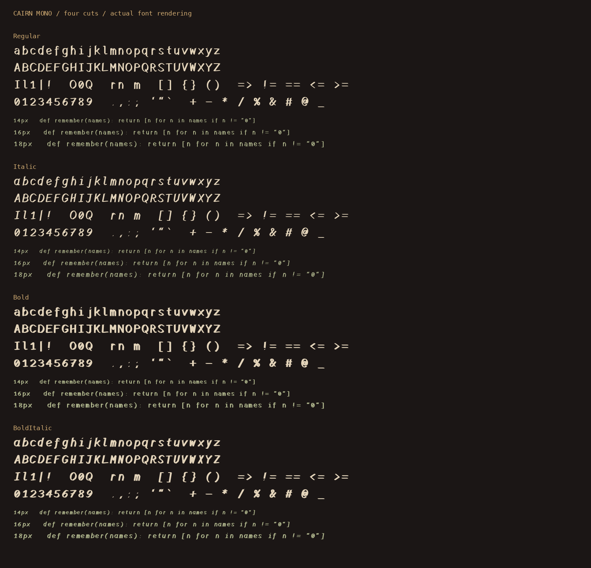

# Cairn & Cairn Mono

Carved typefaces for prose, interfaces, and code. **Cairn** is proportional;
**Cairn Mono** uses equal-width cells. Both include Regular, Italic, Bold, and
Bold Italic, with purpose-drawn glyphs and practical punctuation.

Download the repository and open **specimen.html** for prose or
**mono-specimen.html** for editable code. Both work offline with embedded fonts.
See **README.html** for the quick start and **USAGE.md** for building and validation.

- **desktop/**: eight installable TrueType fonts
- **web/**: eight web fonts, separate external and embedded CSS for each family
- **source/**: independent drawings, builders, and validators
- **proofs/**: actual family, code, prose, and native macOS renderings

Both families cover the same 114 encoded characters. Cairn Mono keeps every
advance at 0.703125 em, with no kerning or ligatures, and refits wide-letter
skeletons while preserving the carved stroke weight. It is a first monospace
edition; no Nerd Font icon patch or manual TrueType hinting is included.

Inherited ornaments have been removed. No reference font is required to build
either family. No distribution license has yet been selected.

## Themes and material

[Hearthstone / Cairn Ash](themes/Cairn-Ash/README.md) includes Everyday and Relic
Obsidian editions, dark/light modes, a Nord comparison, Kitty palettes, and reusable
stone material tokens. Both editions use the same type and control scale.
[Earlier palette studies](themes/Cairn-Dragnipur/README.md) include Ember, Vellum,
and the amber/stone mockups that led to Hearthstone.

Open `themes/Cairn-Ash/compare-nord.html` after downloading for a thorough local
comparison. The previews contain original sample notes, embedded Cairn fonts, and
synthetic interface examples. Local installation state, vault paths and notes,
preferences, and the source desktop painting are excluded.

## Use Cairn in Obsidian

On macOS, open the eight TrueType files in `desktop/` in Font Book and install
them. Restart Obsidian if needed, then choose **Cairn** in Settings → Appearance →
Text font, and **Cairn Mono** for Monospace font if desired. Theme installation is
separate: copy the folders under a theme’s `obsidian/` directory into the vault’s
`.obsidian/themes/` directory, then select the theme in Appearance.

## Compact Mono spacing

Cairn Mono 1.001 reduces the cell from 1536 to 1440 units: **6.25% narrower**,
with the same vertical size, line metrics, and equal advances in every style.
Wide glyph skeletons are refitted before their strokes are drawn; the family is
not globally squeezed. Open [mono-spacing.html](mono-spacing.html) for the
before/after comparison. Dense Bold Italic symbols remain easier to read at
16–18px than at 14px.
