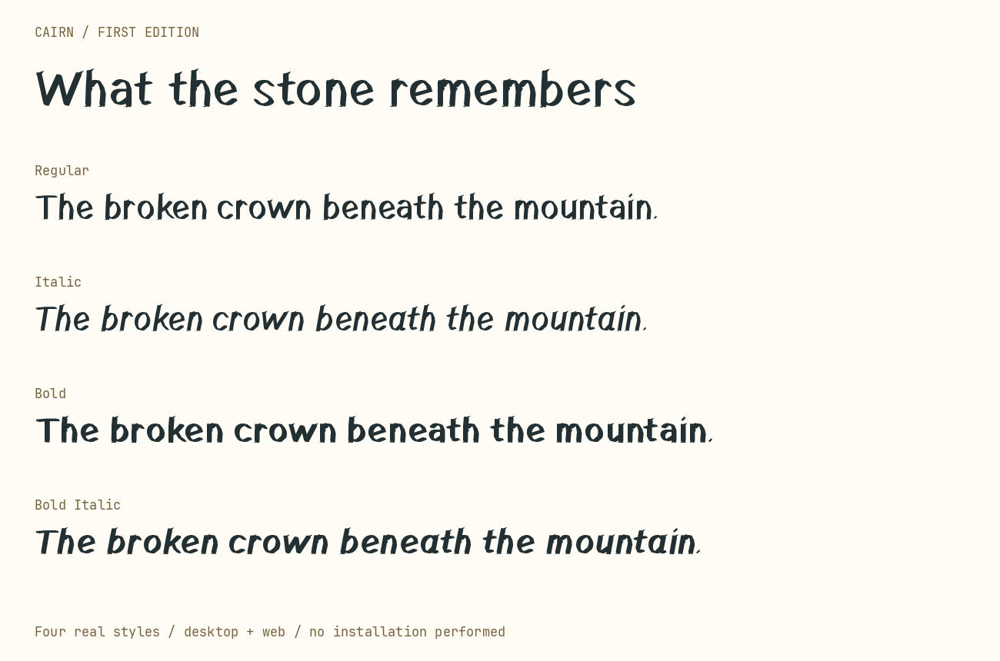

# Cairn

A carved typeface for prose and interfaces, with Regular, Italic, Bold, and Bold Italic.

Download this repository and open **specimen.html** for an offline preview. See **README.html** for the quick start and **USAGE.md** for build instructions and validation.

- **desktop/**: installable TrueType fonts
- **web/**: web fonts, CSS, and an editable HTML example
- **source/**: independent glyph drawings, builders, and validators
- **proofs/**: family, prose, and native macOS renderings

All 114 encoded characters are drawn for Cairn. Earlier inherited ornaments are removed, and no reference font is required to build the family. No distribution license has yet been selected.
